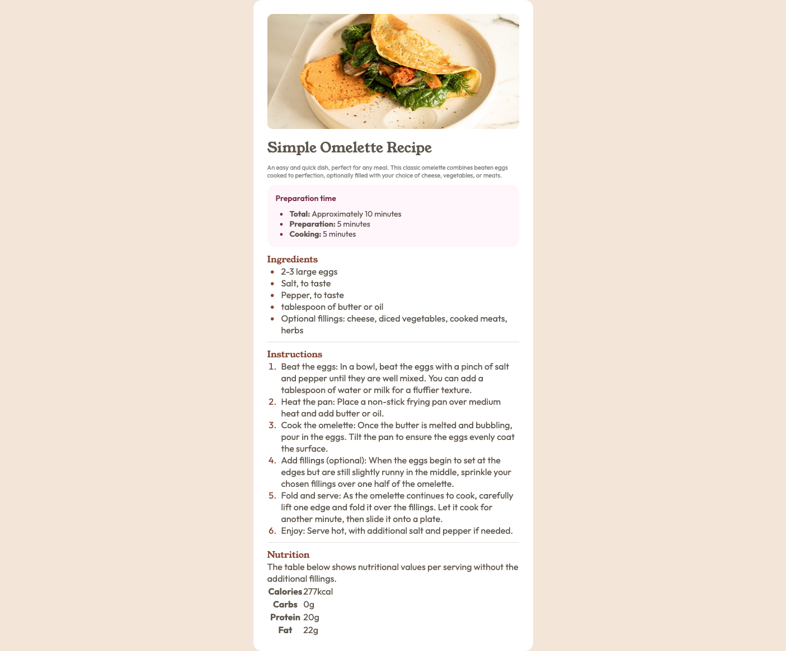

# Frontend Mentor - Recipe page solution

This is a solution to the [Recipe page challenge on Frontend Mentor](https://www.frontendmentor.io/challenges/recipe-page-KiTsR8QQKm).

### Screenshot

### Links

- Live Site URL: https://marksamuelku.github.io/Recipe-page/

## My process

### Built with

- Semantic HTML5 markup
- CSS Flexbox
- [Google Fonts](https://fonts.google.com/) (Outfit, Young Serif)
- Desktop-first workflow (no media queries for mobile)

This list reflects the technologies used in this project.

### What I learned

- **Semantic HTML:** I used `<section>` for each card block (Preparation, Ingredients, Instructions, Nutrition) so the page has a clear structure for screen readers and the document outline.
- **Styling lists:** This was my first time styling lists. I used `::marker` to color list bullets/numbers, and `padding-left` with `list-style-position: outside` to control spacing and alignment.
- **Styling tables:** I learned how to style tables—using `border-collapse: collapse`, styling `th` and `td` (borders, padding, font-weight), and keeping the nutrition table readable and on-brand with the rest of the design.
